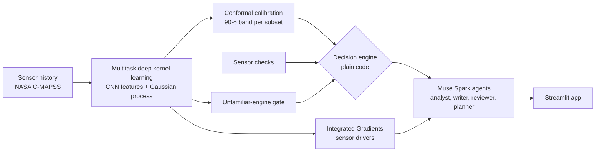

# Engine Health Agent

Calibrated remaining-useful-life (RUL) predictions for turbofan engines, a decision engine that knows when to
abstain, and Muse Spark agents that explain every call.

> **Decision support on NASA's simulated C-MAPSS benchmark.** Not an airworthiness determination: a licensed engineer
> makes the final decision.

**Live app:** LIVE_APP_URL · **Demo video (3 min):** VIDEO_URL

## What it does

1. **Predicts remaining useful life with a 90% band** for every engine, from its sensor history.
2. **Turns the band into one of three calls in plain code**, never by a language model:
   - **🔧 INSPECT** when the chance of failing within the next 30 cycles is at least 50%;
   - **✅ NO_INSPECTION** when it is at most 10%;
   - **⚠️ ABSTAIN** (engineer review) when it is in between, when a sensor looks broken, or when the engine is unlike
     anything in training.
3. **Muse Spark agents explain the call:** which sensors drive it, what to do next, and why the system abstains. A
   safety reviewer checks every briefing, and a planner turns the fleet into a hangar schedule.

**Highlights** (official NASA test engines and 106 held-out engines replayed to failure):
- 0 of 106 failures missed; fixed-interval maintenance misses 42.
- Every injected sensor fault and every unfamiliar engine is refused and sent to an engineer, instead of getting a
  confident wrong number.
- Error in the last 30 cycles before failure, where decisions are made: 3.5–6.5 cycles.
- The 90% bands cover 0.88–0.93 of test engines on three subsets, and 0.83 on FD004.

## How it works



- **Data:**
  - the 14 informative sensors;
  - normalisation per operating condition (k-means; 6 conditions in FD002 and FD004);
  - 30-cycle windows;
  - RUL capped at 125 cycles;
  - splits by engine, never by window: train/validation/calibration/replay = 0.60/0.10/0.15/0.15 of the training
    files. The official test engines are used only for the final evaluation.
- **Model:** a residual 1D CNN with spectral normalisation feeds a sparse variational Gaussian process (GPyTorch). The
  four subsets share three latent processes (linear model of coregionalisation), and each subset gets its own output.
  The model returns a mean, an epistemic uncertainty ("the model hasn't seen engines like this") and an aleatoric
  uncertainty (sensor noise).
- **Calibration:** Mondrian split-conformal, per subset and per predicted-RUL range, with separate lower and upper
  edges. 2.5% of misses are allowed below the band (the unsafe side: the engine had less life than predicted) and
  7.5% above.
- **Decision engine** (`ehagent/decision.py`), checked in this order:
  1. Any sensor flag: ABSTAIN, reason `sensor_integrity`.
  2. Epistemic uncertainty at or above the 99th percentile of calibration engines: ABSTAIN, reason
     `unfamiliar_engine`.
  3. Otherwise compute p, the probability that RUL is at most 30 cycles, from the calibrated band:
     - p ≥ 0.50: INSPECT;
     - p ≤ 0.10: NO_INSPECTION;
     - in between: ABSTAIN, reason `ambiguous_band`.
- **Explanations:** Integrated Gradients against an average healthy-engine window, checked with a deletion test.

## Where Muse Spark is used

| Role | What Muse Spark does | Guardrail |
|---|---|---|
| **Evidence gathering with tools** | The analyst calls `get_engine_status`, `explain_prediction`, `check_sensors` and `what_if_horizon` to collect the facts behind the engineer's question. | The tools are deterministic Python over the model and the decision engine. The true RUL of fleet engines is never exposed to them. |
| **The structured briefing** | The report writer turns the evidence into a JSON briefing: headline, summary, key numbers, sensor drivers, next steps and caveats. | The number guard requires every number to come from a tool output. A failing draft gets one rewrite with the violations listed, then falls back to a deterministic template. The recommendation must equal the decision engine's call. |
| **The safety review** | A reviewer reads every briefing against the evidence and approves it, asks for a revision, or forces ABSTAIN. | It can only escalate (NO_INSPECTION to ABSTAIN), never make a call less cautious. |
| **The hangar plan** | The planner explains a week of inspection and engineer-review slots, starting from the fleet triage. | Its plan is reconciled with a deterministic schedule, and no engine appears twice. |

- **How Muse Spark is called:**
  - model `muse-spark-1.3`, through the Meta Model API (OpenAI-compatible, `https://api.meta.ai/v1`);
  - tool calling;
  - structured output with a JSON schema;
  - low reasoning effort.
- **Cache:** every response is cached on disk, keyed by the full request, so a recorded demo replays offline.
- **What the app shows:**
  - The Ask tab labels every briefing "Written by Muse Spark." or "Shown with the deterministic template." It shows
    the reviewer's verdict and the full tool trace.
  - The Fleet tab says whether the planner agent or the template wrote the plan.

## Safety rules

- The language model never makes the maintenance call; `ehagent/decision.py` does.
- Agents can only escalate.
- Every number an agent writes comes from a tool output.
- The true RUL of fleet engines never reaches an agent or a tool. Only the evaluation and the app's answer-key switch
  use it.
- The app runs with no API key: cached Muse responses replay, and deterministic templates cover the rest.

## The app

- **Fleet:** the 707 official test engines, triaged into the three calls and ranked by risk. "Build plan" schedules
  the week with the planner agent or the template.
- **Engine:**
  - the decision card: the call, the RUL estimate, the 90% band, P(fail within the horizon) and the unfamiliarity
    percentile;
  - the RUL fan chart, with the call at every cycle shown underneath;
  - the sensors driving the estimate, with the faithfulness check;
  - fault injection on any sensor.
- **Ask the agent:** preset or free-text questions about the selected engine, answered by Muse Spark.
- **Evaluation:** the tables and charts below.
- **Sidebar switches:** agents, safety reviewer, planner agent, fault injection, the answer key (true RUL, for
  evaluation only) and the planning horizon.

- **Bring your own engine:** download any engine's data from the Engine tab, edit it (cut cycles, break a sensor) and
  upload it back, or upload any file in NASA's 26-column format. The full pipeline and the agents run on it. Uploaded
  engines have no answer key and never enter the fleet, the plan or the evaluation.

## Results

Model `dkl_multitask` (multitask deep kernel learning, 30-cycle window). Every table below is printed from
`reports/metrics.json` and `reports/rul_stage_report_dkl_multitask.json` by the two scripts named in "Run it".

### Accuracy and calibration

Scored at the last cycle of each official test engine, with true RUL capped at 125 (the standard protocol).

| Subset | RMSE | NASA score | 90% band coverage | Mean band width (cycles) | RMSE when true RUL <= 30 |
|---|---|---|---|---|---|
| FD001 | 13.98 | 447 | 0.88 | 42.2 | 3.51 |
| FD002 | 14.24 | 1054 | 0.92 | 52.7 | 5.24 |
| FD003 | 14.02 | 413 | 0.93 | 41.5 | 3.96 |
| FD004 | 15.49 | 1507 | 0.83 | 48.4 | 6.47 |

- **The NASA score sums an asymmetric penalty over all test engines,** so subsets with more engines score higher.
  Late predictions cost more than early ones, and lower is better. Per engine the scores are 4.5, 4.1, 4.1 and 6.1.
- **Against uncapped truth, RMSE is 15.16, 26.46, 15.22 and 27.17.** The FD002 and FD004 test files include engines
  with far more than 125 cycles left. The model reports those as "healthy, at least 125" rather than guessing.
- **Multitask vs single-task:** the multitask model is more accurate than single-task models on all four subsets, by
  0.6–1.3 cycles.
- **Against published models:** STAR (2024), a strong published point predictor, reports 10.61, 13.47, 10.71 and
  15.87. We're behind on three subsets and ahead on FD004. STAR gives one number per engine, with no band and no way
  to abstain. A few 2024–2025 papers report lower RMSE on some subsets (for example 11.58 on FD002 and 12.38 on
  FD004, arXiv:2507.09766), mostly without stating where each test engine is scored or the RUL cap, so protocols
  differ between papers.

### Maintenance policies

| Policy (held-out engines replayed to failure) | Missed failures | Unnecessary inspections | Engineer reviews | Median warning lead (cycles) |
|---|---|---|---|---|
| fixed interval | 42/106 | 359 | 0 | 13 |
| point estimate | 0/106 | 35 | 0 | 25 |
| uncertainty aware | 0/106 | 35 | 264 | 25 |

- **Fixed-interval maintenance (every 50 cycles) misses 40% of failures.** Both condition-based policies catch every
  one.
- **On clean data our inspections match a well-tuned point estimate exactly, and that's by design.** "At least a 50%
  chance of failing within 30 cycles" is the same rule as "predicted RUL at most 30". On the replay engines the two
  agree on 100% of cycles where neither safety gate fired.
- **The thresholds were chosen on validation engines** with `scripts/policy_sweep.py`. Rules that time inspections
  from the band's tail did worse: even the most cautious one, "a 2% chance of fewer than 10 cycles left", caught 5 of
  106 failures late.
- **What the uncertainty adds is an earlier heads-up.** 105 of 106 engines got an engineer-review flag before their
  first inspection, a median of 13 cycles earlier (half between 8 and 19). Reviews are counted separately and never
  credited as catches.

### Where the uncertainty pays off

Sensor faults on Ps30 (s11), 30 FD001 test engines (abstain rate without a fault: 7%):

| Fault | Abstained | Sensor flagged | Decision changed | Mean RUL shift (cycles) |
|---|---|---|---|---|
| stuck | 100% | 100% | 93% | +1.8 |
| drift | 100% | 70% | 93% | -76.8 |
| spike | 100% | 100% | 93% | -61.0 |
| noise | 100% | 100% | 93% | +12.4 |

Explanation faithfulness (30 FD001 test engines): median ratio 1.59, above 1 for 70% of engines.

Unfamiliar engines: FD004 engines fed to the FD001 model were abstained on 100% of the time, vs 11% for real FD001
engines.

- **A stuck sensor is the dangerous case.** The estimate barely moves (+1.8 cycles), so a point estimate looks normal
  while it's built on a dead sensor.
- **Drift got past the sensor checks on 30% of engines,** and the model's own uncertainty caught every one of them.
- **Noise inflates remaining life by about 12 cycles,** which is the unsafe direction.
- **Faithfulness:** resetting the three sensors the explanation ranks highest moves the estimate 1.59 times more than
  resetting three random sensors.

### Accuracy and band width over an engine's life

Held-out replay engines, every cycle:

| True RUL left | Cycles | Median band width (cycles) | Coverage | Abstained | Inspected |
|---|---|---|---|---|---|
| 0-30 | 3180 | 13 | 0.91 | 17% | 81% |
| 30-60 | 3180 | 40 | 0.90 | 28% | 5% |
| 60-90 | 3180 | 66 | 0.91 | 2% | 0% |
| 90-125 | 3710 | 58 | 0.90 | 1% | 0% |
| above 125 | 8956 | 58 | 0.89 | 2% | 0% |

Official test engines, last cycle (mean error above 0 means the model predicted more life than was left):

| True RUL left | Engines | RMSE (cycles) | Mean error (cycles) | Share of squared error |
|---|---|---|---|---|
| 0-30 | 157 | 5.3 | +2.6 | 3% |
| 30-60 | 115 | 14.3 | +6.6 | 16% |
| 60-90 | 122 | 22.7 | +11.6 | 42% |
| 90-125 | 163 | 14.8 | +0.3 | 23% |
| above 125 | 150 | 12.8 | -9.0 | 16% |

- **Wide early, narrow late.** Early in life nobody can know when wear will start, so the band is wide. In the last
  30 cycles it's 13 cycles wide, and coverage holds near 90% at every stage.
- **Most of the error comes from engines 60–90 cycles from failure.** They still look healthy, so the model
  over-predicts. The prediction leaves the 125-cycle cap with a median of 91 cycles left, while the target starts
  falling at 125.

### What we tried and didn't keep

- **A 50-cycle input window with single-task models.** It cut pooled validation RMSE from 15.3 to 13.8 cycles and was
  more accurate on every subset. But for FD003 engines 30–60 cycles from failure, its band missed below 24% of the
  time, against 7% for the current model (validation, `scripts/check_calibration.py`). That's the range where the
  inspect decision is made, so we kept the safer model.
- **Choosing the model per subset.** On our validation splits (10–26 engines per subset), the per-subset differences
  between multitask and single-task were within noise, so we use one multitask model everywhere.

## Limits

- **C-MAPSS is a simulation.** This is decision support, not an airworthiness determination.
- **Coverage falls short in two places:** FD004's test coverage is 0.83 against the 90% target, and FD003's
  validation coverage is 0.84 (0.72 for engines 60–90 cycles from failure).
- **Point accuracy is behind the best published models on three subsets.**
- **The fixed 125-cycle cap** assumes every engine starts wearing 125 cycles before failure. In reality the onset
  varies, and this is the main source of error.
- **The sensor faults are synthetic injections** with fixed sizes: stuck; drift of 3 standard deviations per 10
  cycles; a 12-standard-deviation spike; noise of 3 standard deviations.
- **The validation splits are small:** 10–26 engines per subset.
- **Calls are computed cycle by cycle,** so they can flicker near a threshold. In operation the inspection is booked
  at the first INSPECT, which is what the replay's cooldown models.

## Run it

### Requirements

- **Python:** 3.10 or newer (tested with 3.10 and 3.13).
- **NASA C-MAPSS data:** the 12 text files are in `CMAPSSData/`, from
  [CMAPSS Jet Engine Simulated Data](https://data.nasa.gov/dataset/cmapss-jet-engine-simulated-data) on NASA's Open
  Data Portal.
- **Hardware:** a CUDA GPU is recommended for training. Calibration, evaluation and the app run on CPU
  (`project.device: auto`).
- **Optional:** a Meta Model API key, for live Muse Spark.

```bash
git clone https://github.com/Chandresh-Gohel/NASA_CMAPSS_Meta_Global_AIHT.git
cd NASA_CMAPSS_Meta_Global_AIHT
pip install -r requirements.txt   # PyTorch's CPU build: enough for the app and the evaluation
# GPU training (Option B): install the CUDA build of PyTorch from pytorch.org first
cp .env.example .env        # Windows: copy .env.example .env ; then add MODEL_API_KEY (optional)
```

### Option A: use the trained artifacts

The repo includes what the app needs: the trained models, calibration, prepared data and precomputed results in
`artifacts/`, the evaluation report in `reports/`, and cached Muse Spark responses in `.cache/llm/`. Start the app:

```bash
streamlit run app/streamlit_app.py
```

### Option B: run the full pipeline

```bash
python -m ehagent.train prepare
python -m ehagent.train baseline --mode multitask
python -m ehagent.train dkl --mode multitask
python -m ehagent.train baseline --mode single
python -m ehagent.train dkl --mode single
python -m ehagent.calibrate --mode both
python -m ehagent.precompute --mode both
python -m ehagent.evaluate
python scripts/results_table.py
python scripts/rul_stage_report.py
streamlit run app/streamlit_app.py
```

`python scripts/policy_sweep.py` reproduces the threshold choice and its trade-off chart.

### Run without an API key

```bash
EHA_OFFLINE=1 streamlit run app/streamlit_app.py                 # bash
$env:EHA_OFFLINE="1"; streamlit run app/streamlit_app.py         # PowerShell
```

With no key, or with `EHA_OFFLINE=1`, cached Muse Spark responses replay. Everything else comes from deterministic
templates, and the app labels which is which.

### Checks

`python scripts/check_<step>.py` for steps 1 and 3–13 runs offline with no API key.
`python scripts/check_calibration.py --mode multitask` (and `--mode single`) reports validation coverage with
bootstrap intervals. `python scripts/check_upload.py` verifies uploaded engine files end to end (offline; `--live`
adds one cached live briefing). `python scripts/probe_offtopic.py --live` shows what the agent does with
non-engine questions. `python scripts/check_12.py --live` adds three live briefings (needs a key).

## Configuration

Every tunable lives in `configs/default.yaml`. The main values:

| Setting | Value |
|---|---|
| Input window | 30 cycles |
| RUL cap | 125 cycles |
| Band | 90% (2.5% of misses allowed below the band, 7.5% above) |
| Planning horizon | 30 cycles |
| INSPECT / NO_INSPECTION thresholds on P(fail within the horizon) | ≥ 0.50 / ≤ 0.10 |
| Unfamiliar-engine gate | 99th percentile of epistemic uncertainty |

Environment variables:

| Variable | Purpose |
|---|---|
| `MODEL_API_KEY` | Meta Model API key |
| `MUSE_MODEL` | Muse Spark model; default `muse-spark-1.3` |
| `MODEL_API_BASE_URL` | API base URL; default `https://api.meta.ai/v1` |
| `EHA_OFFLINE` | `1` = never call the API |
| `EHA_CONFIG` | path to another config file |

## Repository layout

```
app/streamlit_app.py    Streamlit app: Fleet, Engine, Ask the agent, Evaluation
ehagent/                data, models, calibration, decision engine, sensor checks, faults, explanations,
                        service layer, planner, replay, evaluation, uploaded engines
ehagent/agent/          Muse Spark client, tools, schemas, number guard, templates, orchestrator
prompts/                system prompts for the analyst, report writer, safety reviewer and planner
configs/default.yaml    every tunable
scripts/                exit checks, results tables, policy sweep, stage report, diagnostics
docs/SPEC.md            the full design spec (AGENTS.md section 3 lists what to ignore)
.streamlit/config.toml  upload size cap (matches configs/default.yaml)
AGENTS.md               project instructions for Muse Code
log/workdone.md         continuous build log across sessions
artifacts/              trained models, calibration, prepared data, precomputed results (Option B rebuilds them)
reports/                metrics.json and the charts from the evaluation run
.cache/llm/             cached Muse Spark responses (replayed with EHA_OFFLINE=1)
CMAPSSData/             the NASA C-MAPSS text files
```

## What's next

- **NASA N-CMAPSS:** real flight profiles, wear onset known for each engine (replacing the fixed cap), and five
  components that can wear.
- **Longer input windows with recalibration,** since the 50-cycle window helped accuracy but broke calibration.
- **Choosing the model per subset with cross-validation over engines.**
- **Product features:** hysteresis, so a call doesn't flicker; a review queue where engineers record what each
  ABSTAIN turned out to be; an audit log; drift monitoring with recalibration; work orders sent to a maintenance
  system.

## Data and references

- A. Saxena, K. Goebel, D. Simon, N. Eklund. "Damage Propagation Modeling for Aircraft Engine Run-to-Failure
  Simulation." PHM 2008. Data: [NASA Open Data Portal](https://data.nasa.gov/dataset/cmapss-jet-engine-simulated-data).
- A. G. Wilson, Z. Hu, R. Salakhutdinov, E. P. Xing. "Deep Kernel Learning." AISTATS 2016.
- J. Gardner, G. Pleiss, D. Bindel, K. Weinberger, A. G. Wilson. "GPyTorch: Blackbox Matrix-Matrix Gaussian Process
  Inference with GPU Acceleration." NeurIPS 2018.
- V. Vovk, A. Gammerman, G. Shafer. *Algorithmic Learning in a Random World.* Springer, 2005 (Mondrian conformal
  prediction).
- J. Lei, M. G'Sell, A. Rinaldo, R. Tibshirani, L. Wasserman. "Distribution-Free Predictive Inference for
  Regression." JASA 2018.
- M. Sundararajan, A. Taly, Q. Yan. "Axiomatic Attribution for Deep Networks." ICML 2017.
- T. Miyato, T. Kataoka, M. Koyama, Y. Yoshida. "Spectral Normalization for Generative Adversarial Networks." ICLR 2018.
- Z. Fan, W. Li, K.-C. Chang. "A Two-Stage Attention-Based Hierarchical Transformer for Turbofan Engine Remaining
  Useful Life Prediction" (STAR). Sensors 24(3), 824, 2024.

## Acknowledgements

Built for the Meta Global AI Developer Hackathon 2026 (Indie track). Muse Spark powers the agents through the Meta
Model API. Development used Muse Code with the instructions in `AGENTS.md`.
